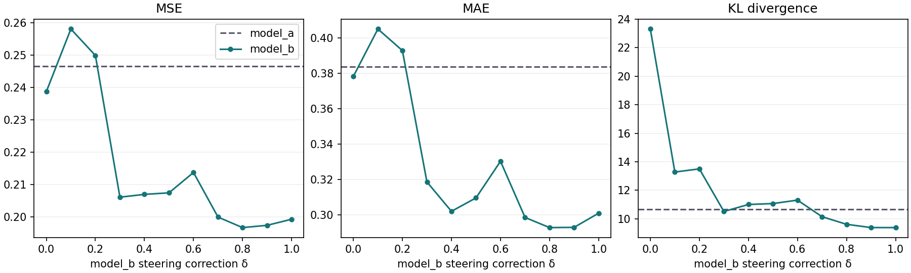
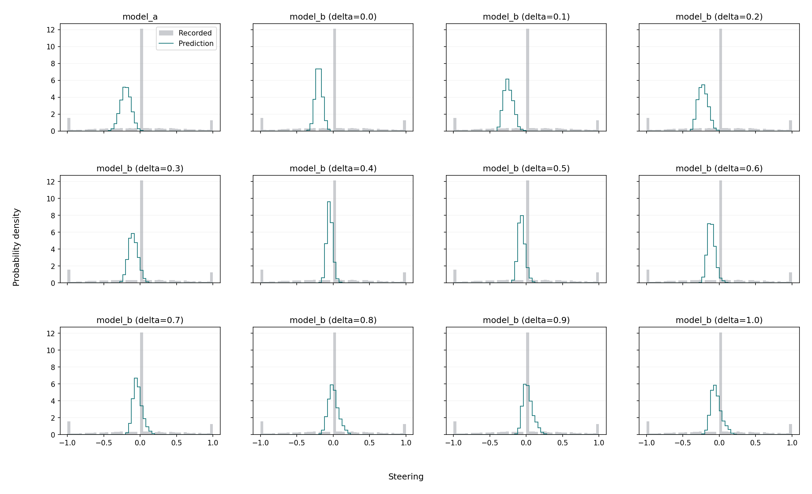
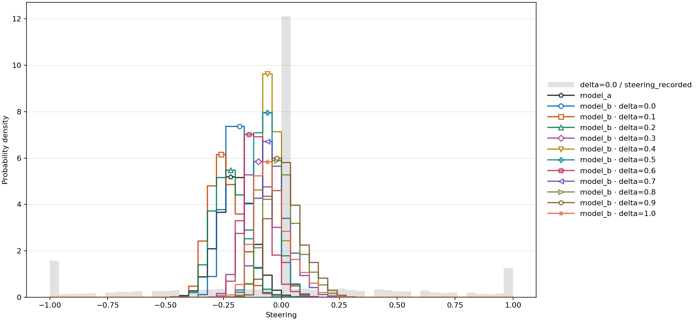

# 1주차 실험 결과 · 측면 카메라 조향 보정의 효과

model_b의 측면 조향 보정 크기 δ를 0.0부터 1.0까지 0.1씩 바꾼 11개 실험을 동일한 Track 2에서 비교했다. **이번 실행에서 프레임별 오차(MSE·MAE)는 δ=0.8일 때, 조향 분포의 KL은 δ=1.0일 때 가장 낮았다.**

## 비교 조건

- **model_a**는 Track 1의 앞쪽 8,492개 시점에서 정면 영상과 기록된 조향값 `s`를 학습했다. **model_b**는 같은 시점의 세 카메라 영상 25,476장을 사용했다. 학습 목표는 정면 `s`, 왼쪽 `s + δ`, 오른쪽 `s − δ`다. δ=0에서도 측면 영상을 학습한다.
- 모든 실행에서 사전학습 ResNet-18, Adam, 학습률 0.0001, 배치 크기 32, 시드 42, 10에폭을 사용했다. 10에폭 동안 업데이트 횟수는 model_a가 2,660회, model_b가 7,970회다. 따라서 A/B 비교에는 카메라 구성과 학습량 차이가 함께 들어간다. 보정 크기 자체의 효과는 동일한 데이터를 사용한 model_b 실행끼리 비교한다.
- 모든 실행은 Track 1의 뒤쪽 정면 영상 2,123장으로 검증하고, Track 2의 정면 영상 21,828장으로 평가했다. KL은 실측 분포에서 예측 분포로 계산했으며, 11개 실행의 히스토그램 구간은 동일하다.

## 검증과 OOD 테스트 결과

모든 지표는 낮을수록 좋다. 모델 이름은 해당 실행의 평가 CSV로 연결된다.

| 모델 | δ | Track 1 Val MSE | Track 2 MSE | Track 2 MAE | Track 2 KL |
|---|---:|---:|---:|---:|---:|
| [model_a](20261122_155143_272935/metrics.csv) | — | 0.02048 | 0.24651 | 0.38386 | 10.658 |
| [model_b](20261122_155143_272935/metrics.csv) | 0.0 | 0.01845 | 0.23872 | 0.37835 | 23.311 |
| [model_b](20261122_162637_800012/metrics.csv) | 0.1 | 0.01880 | 0.25808 | 0.40514 | 13.278 |
| [model_b](20261122_164356_136009/metrics.csv) | 0.2 | 0.01703 | 0.24990 | 0.39295 | 13.498 |
| [model_b](20261122_165557_297405/metrics.csv) | 0.3 | 0.01734 | 0.20606 | 0.31862 | 10.511 |
| [model_b](20261122_170759_223871/metrics.csv) | 0.4 | 0.01753 | 0.20692 | 0.30202 | 11.001 |
| [model_b](20261122_171916_985590/metrics.csv) | 0.5 | 0.01790 | 0.20740 | 0.30961 | 11.065 |
| [model_b](20261122_173624_894823/metrics.csv) | 0.6 | 0.01879 | 0.21370 | 0.33033 | 11.306 |
| [model_b](20261122_175243_281748/metrics.csv) | 0.7 | 0.01707 | 0.19990 | 0.29855 | 10.146 |
| [model_b](20261122_180415_110759/metrics.csv) | 0.8 | 0.01721 | 0.19664 | 0.29280 | 9.611 |
| [model_b](20261122_181509_543932/metrics.csv) | 0.9 | 0.01771 | 0.19735 | 0.29294 | 9.382 |
| [model_b](20261122_182729_964682/metrics.csv) | 1.0 | 0.01773 | 0.19923 | 0.30095 | 9.380 |

### 델타에 따른 차이

- 보정량을 키울 때 오차가 일관되게 감소하지는 않았다. 같은 세 카메라를 사용한 model_b의 Track 2 MSE는 δ=0.0에서 0.23872, δ=0.1에서 0.25808로 증가했고, δ=0.3에서는 0.20606으로 감소했다.
- **테스트에서 관찰한 최저 MSE·MAE는 δ=0.8**이었다. MSE 0.19664, MAE 0.29280으로 model_a보다 각각 약 20.2%, 23.7% 낮았다. δ=0.9의 MAE도 0.29294로 매우 가깝다. KL 최솟값은 δ=1.0에서 나왔으므로, 전체 분포가 가장 유사한 모델과 프레임별 오차가 가장 작은 모델은 달랐다.
- 모든 프레임에 조향값 0을 예측하면 Track 2 MSE는 0.21351, MAE는 0.28534다. δ=0.8은 이 단순 기준보다 MSE가 낮았지만 MAE는 높았다. model_a 대비 개선만으로 새 트랙에서 조향을 충분히 정확하게 예측한다고 판단하기는 어렵다. [Track 2 원본 목표값](../../splits/test.csv)

### 예측 분포

δ=0.0의 model_b는 Track 2에서 예측이 음수 쪽으로 쏠렸다. 히스토그램 구간 중앙값으로 근사한 평균 예측은 −0.197에서 δ=0.8일 때 +0.004로 이동했다. 그러나 δ=0.8에서도 실제 조향 분포의 양쪽 꼬리를 재현하지 못했다. 같은 히스토그램에서 −1과 +1에 가장 가까운 두 끝 구간을 보면, 실측 조향은 양 끝에 모두 존재하지만 model_b의 예측은 모든 δ에서 두 구간 모두 0건이다. 분포의 중심이 이동했다는 관찰만으로 개별 급커브의 조향이나 복귀 동작이 개선됐다고 단정할 수 없다.

## 해석 범위

이번 결과는 **시드 하나에서 관찰한 오프라인 조향 예측 성능**이다. δ=0.8과 0.9의 작은 차이를 검증하려면 여러 시드에서 반복해야 한다. 차선 이탈 후 실제로 중앙으로 복귀하는지는 별도의 시뮬레이터 주행에서 복귀 성공률이나 차선 이탈 횟수로 확인할 수 있다.
